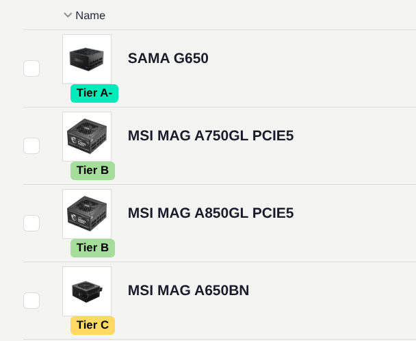
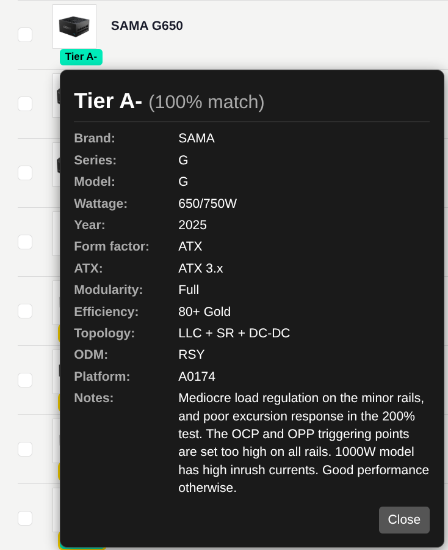
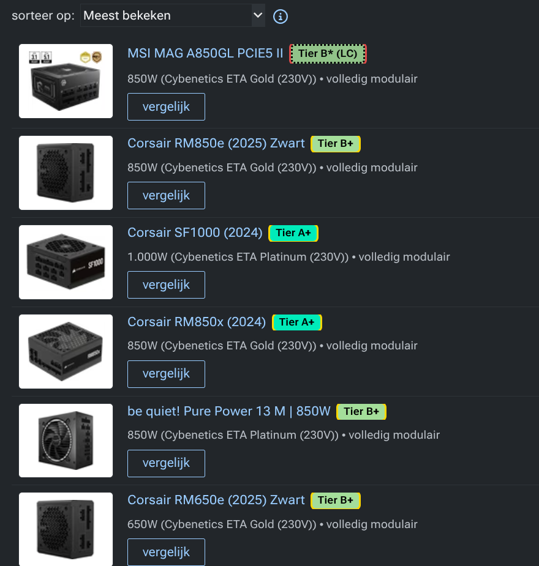

# PSU Tier List Userscript 🔌

[](https://addons.mozilla.org/en-US/firefox/addon/psu-tier-badges/)
[](https://chromewebstore.google.com/detail/psu-tier-badges-pcpartpic/ngjfcbgocgihemnfbfffikmcdpplhemf)
[](https://github.com/FeikoWielsma/psu-tier-userscript/actions)
[](https://github.com/FeikoWielsma/psu-tier-userscript/releases)
[](#-installation)
[](https://github.com/FeikoWielsma/psu-tier-userscript/blob/main/LICENSE)
[](https://github.com/astral-sh/ruff)
[](https://eslint.org/)

A tool that turns **SPL's PSU Tier List** (a Google Sheet) into a userscript that
injects coloured **Tier badges** directly onto power-supply listings on
**PCPartPicker** (all regions) and **Tweakers.net**, so you can judge PSU quality
at a glance.

A solid badge indicates a **strong match**; a dashed `Tier X?` badge indicates
a **likely match**. Click for specifications, alternate identities and a
similarity score from 0 to 1. That score is **not a probability of correctness**.
Explicit generation conflicts are rejected; unspecified generations stay likely.

> [!WARNING]
> Manufacturer naming is inconsistent across the tier sheet, PCPartPicker and
> Tweakers (and those three disagree with each other). The matcher is good but
> **false positives/negatives happen** — always confirm on the
> [official spreadsheet](https://docs.google.com/spreadsheets/d/1akCHL7Vhzk_EhrpIGkz8zTEvYfLDcaSpZRB6Xt6JWkc/htmlview)
> before buying. The match band and "other possible matches" list are there
> to make disagreement visible rather than hidden.

## 🚀 Installation

The easiest way is the **official store listing** for your browser — one click,
with automatic updates. Prefer not to use a store? Manual and userscript options
are below.

### Option 1: Official browser stores (Recommended)

<table>
  <tr>
    <td align="center" width="50%">
      <a href="https://addons.mozilla.org/en-US/firefox/addon/psu-tier-badges/">
        <br>
        🦊 <b>Get it for Firefox</b>
      </a>
    </td>
    <td align="center" width="50%">
      <a href="https://chromewebstore.google.com/detail/psu-tier-badges-pcpartpic/ngjfcbgocgihemnfbfffikmcdpplhemf">
        <br>
        🟢 <b>Get it for Chrome</b>
      </a>
    </td>
  </tr>
</table>

- **Firefox** → [**Add to Firefox**](https://addons.mozilla.org/en-US/firefox/addon/psu-tier-badges/) from Mozilla Add-ons (AMO).
- **Chrome** → [**Add to Chrome**](https://chromewebstore.google.com/detail/psu-tier-badges-pcpartpic/ngjfcbgocgihemnfbfffikmcdpplhemf) from the Chrome Web Store.
- **Brave, Edge, Opera, Vivaldi & other Chromium browsers** → install straight
  from the **[Chrome Web Store](https://chromewebstore.google.com/detail/psu-tier-badges-pcpartpic/ngjfcbgocgihemnfbfffikmcdpplhemf)** link above — these browsers accept
  Chrome Web Store extensions directly. Notes:
  - **Brave**: open the Chrome Web Store link, click **Add to Brave**. If
    prompted, allow Chrome Web Store extensions (Brave enables this by default).
  - **Edge**: open the link in Edge; the first time you may see a banner to
    **Allow extensions from other stores** — click it, then **Add to Chrome →
    Add extension**.
  - **Opera**: install **[Install Chrome Extensions](https://addons.opera.com/extensions/details/install-chrome-extensions/)** first, then use the Chrome
    Web Store link.

---

### Option 2: Manual install (no store account / sideload)

#### Firefox
1. Go to the [**Releases**](https://github.com/FeikoWielsma/psu-tier-userscript/releases) page.
2. Download the signed `psutier-extension.xpi` file.
3. Open Firefox, drag and drop the `.xpi` file into the browser (or press `Ctrl+O` / `Cmd+O` and select it) to install it. No extension manager required!

#### Chrome / Brave / Edge
1. Download `psutier-extension.zip` from the [**Releases**](https://github.com/FeikoWielsma/psu-tier-userscript/releases) page and extract it.
2. Open `chrome://extensions`, `brave://extensions`, or `edge://extensions`.
3. Toggle **Developer mode** on (top-right).
4. Click **Load unpacked** and select the extracted folder.

---

### Option 3: Userscript (Requires Manager)

1. Install a userscript manager:
   - **Brave / Chrome / Edge** (Chromium): install **Violentmonkey** (or
     Tampermonkey) from the Chrome Web Store.
   - **Firefox**: install Violentmonkey/Tampermonkey from Add-ons.
2. **Brave/Chrome only — enable user scripts** (required since Chromium tightened
   Manifest V3): open the extension's *Details*, and turn on **"Allow User
   Scripts"** if shown; on older builds toggle **Developer mode** on
   `brave://extensions` instead. (One-time step.)
3. Download the latest `psutier.user.js` from the
   [**Releases**](https://github.com/FeikoWielsma/psu-tier-userscript/releases)
   page — your manager will offer to install it.

---

### Option 4: Tweakers custom CSS (no extension, Tweakers only)

Tweakers' own **custom CSS** carries the tier badges with no extension or
userscript manager at all — just enable the shared snippet:

> **▶ [Enable the snippet on Tweakers](https://tweakers.net/instellingen/customcss/snippets/bekijk/3538/)** — toggle it on and reload the Pricewatch.

It's **Tweakers Pricewatch only** (no PCPartPicker) and a static snapshot of the
tier list — new products / tier changes appear when the snippet is updated.

To (re)generate it yourself (or build a different variant), see
[`tools/README-tweakers-css.md`](tools/README-tweakers-css.md):

- **boxed** (default, ~40 KB) — filled tier pills, matching the extension's look.
- **lite** (~37 KB) — colored tier letter only.
- **popup** — pills **plus** a hover spec popup, abusing `::before` `content`.

---

Finally, visit a [PCPartPicker PSU listing](https://pcpartpicker.com/products/power-supply/) or the [Tweakers Pricewatch](https://tweakers.net/voedingen/vergelijken/) and look for the badges.

## 📸 Screenshots

### Badges on PCPartPicker


### Detail Specs Popup (after clicking badge)


### Badges on Tweakers.net


## 🧠 How it works

```
Google Sheet ── snapshot.py --refresh ──► frozen CSVs + metadata + semantic diff
                                              │ review and commit
                                              ▼
                         tests/fixtures/sample_psu_data.json
                                              │
        ┌── src/matcher.js  (shared matching engine)
        ├── src/adapters.js (site extraction)
        ├── data/normalization_rules.json (naming rules)
        └── src/userscript.template.js (UI)
                                              │
                        generate_userscript.py ──► psutier.user.js
                                              │
                           build_extension.py ──► extension ZIP
                                              │
                     test_suite.py --release ──► validation attestation
```

- **Data source** is the sheet's `gviz` **CSV export** (stable columns, no HTML
  scraping, no third-party Python deps).
- **Matching** (`src/matcher.js`) tokenizes the product name and each candidate
  model and scores a weighted token overlap. It also uses the storefront's
  **structured columns** as signals, not just the name: wattage and form factor
  (ATX vs SFX) are hard filters, and efficiency disambiguates variants. When a
  name is too thin to score on its own (e.g. "NZXT C750" → just "c"), those
  signals resolve it by constraint (wattage + efficiency + form factor). Explicit model years, generations, revisions and named editions must agree;
  ambiguous identities are downgraded even when their tiers agree. The
  winning score is a similarity measure shown in the detail popup. This is the **single
  source of truth** — the userscript and the test suite run the exact same code.
- There are **no hardcoded per-product hacks.** Naming quirks are fixed by
  editing data, not code (see below).

### Fixing a naming mismatch (the extension point)

Edit [`data/normalization_rules.json`](data/normalization_rules.json):

- `aliases` — rewrite incoming product names (e.g. ASUS `"850G"` → `"850 gold"`).
- `strip` — remove descriptors that differ across sources and never identify a
  model (ATX version tags, the `80+` prefix, …); applied to both sides.
- `generic` / `noise` — words that score low / are dropped.
- `identity` — meaningful revision, variant and family vocabulary.
- `thresholds` / `weights` — match bands and scoring balance.

Identity qualifiers are checked before descriptors are stripped. Aliases must
not erase explicit conflicting generations. Include wrong-model and forbidden
alternate assertions when changing naming rules.

Add a case to [`tests/corpus.json`](tests/corpus.json), run `npm test`, done.

### Supporting a new site

Add one entry to [`src/adapters.js`](src/adapters.js):
`{ id, match, selector, filter?, extract, insertBadge }`, where `extract(row)`
returns `{ name, wattage, efficiency, formFactor, modular }` (pull as many of
those from structured columns as the site exposes — the matcher uses them).

## 🛠️ Development

**Prerequisites:** Python 3, Node.js 20.19+ and [uv](https://docs.astral.sh/uv/).

```bash
npm ci
node node_modules/playwright/cli.js install chromium
python test_suite.py --release
python verify_artifacts.py
```

The full gate validates frozen CSV provenance, lint/types, matcher contracts,
reviewed identity benchmarks, parser/build failure handling, browser behavior,
and the exact generated userscript and extension ZIP. It needs no live sheet or
storefront requests. Initial dependency/browser installation and uv tool setup
require network access. CI installs Chromium's system dependencies too.

For local iteration:

```bash
python test_suite.py --quick  # skips browser checks; cannot attest a release
node tools/check.cjs          # lint, types and offline JavaScript checks
node tools/check.cjs --browser
node tools/benchmark.cjs
node tools/benchmark.cjs --holdout
```

### Updating the sheet snapshot

```bash
python snapshot.py --refresh
```

Review the frozen exports, `tests/fixtures/sheet/diff.json`, metadata and parsed
snapshot together. Check changed names, generations, tiers, duplicate identities,
conflicts and missing fields against the source rows. Update affected regression
expectations and reviewed benchmark labels from source evidence, not matcher
predictions. Dataset changes intentionally invalidate benchmark hash policies.
Run the full release gate, inspect its reports, and commit the complete snapshot
bundle and justified expectation changes before tagging a release.

`python generate_userscript.py` builds from the committed snapshot. `--data PATH`
selects alternative data for local investigation; the release gate always uses
the committed snapshot. Refreshing never publishes.

### What the tests measure

The curated corpus asserts identities, tiers, uncertainty and forbidden matches.
Saved storefront coverage is informational; adding wrong matches cannot make a
coverage gate pass. Adapter checks include real saved rows before and after badge
insertion. Chromium tests cover row reuse/replacement, unknown generations,
limited/unrated/tier filters, popups, responsive bounds, preferences and actual
manifest injection. Targeted mutation checks verify that generation, ambiguity
and wattage protections are exercised.

The 300-product reviewed sample is development evidence. A separate 50-product
sample excludes its families and curated regression families. Reviews compare
saved records with frozen sheet rows; they have **not been verified by a human
or manufacturer**. Unresolved identities stay visible and are excluded from
resolved-case precision. The frames are saved convenience samples, so neither
coverage nor benchmark precision establishes a live-catalog error rate. See
[validation results and limitations](docs/testing-results.md).

### Live checks

```bash
node tools/live_capture.mjs --capture
node tools/live_capture.mjs --smoke
```

Live captures go to `reports/captures/` for review and never overwrite committed
fixtures. Smoke checks record the script hash, injection, runtime errors and a
popup interaction in `reports/live-smoke.json`: exit 0 means passed, 1 failed,
2 inconclusive (network, consent, challenges or missing listing selectors).
These checks are on demand and separate from deterministic CI. They do not
validate every returned identity. Use `--headed`, `--channel=chrome|msedge` or
`--browser-path=...` for a local installed browser.

## 🤖 CI/CD

CI and tagged releases run the same full offline gate. Releases build only the
reviewed committed snapshot. Immediately before each publishing step, hashes and
source/test inputs must still match the successful validation attestation.
Signed Firefox packages, when present, must preserve the tested application
files. This content comparison does not verify Mozilla's signature itself.

The manually dispatched snapshot-health workflow produces a candidate refresh
artifact for review. It neither commits changes nor publishes a release.

## ☕ Support development

If you find PSU Tier Badges useful, you can [support development on Ko-fi](https://ko-fi.com/feiko).
Contributions are optional and support maintenance of this extension and userscript.
PSU ratings are provided by SPL's PSU Tier List, credited below.

## 📜 Credits

- **Data**: [SPL's PSU Tier List](https://docs.google.com/spreadsheets/d/1akCHL7Vhzk_EhrpIGkz8zTEvYfLDcaSpZRB6Xt6JWkc/htmlview).
- **PCPartPicker** and **Tweakers.net** for the platforms this enhances.

---
*Not affiliated with PCPartPicker, Tweakers, or the spreadsheet maintainers.*
